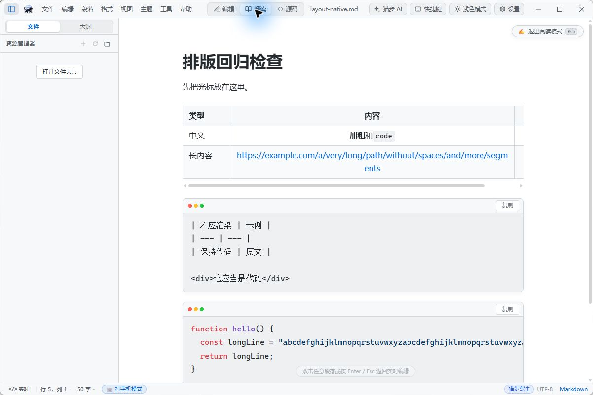
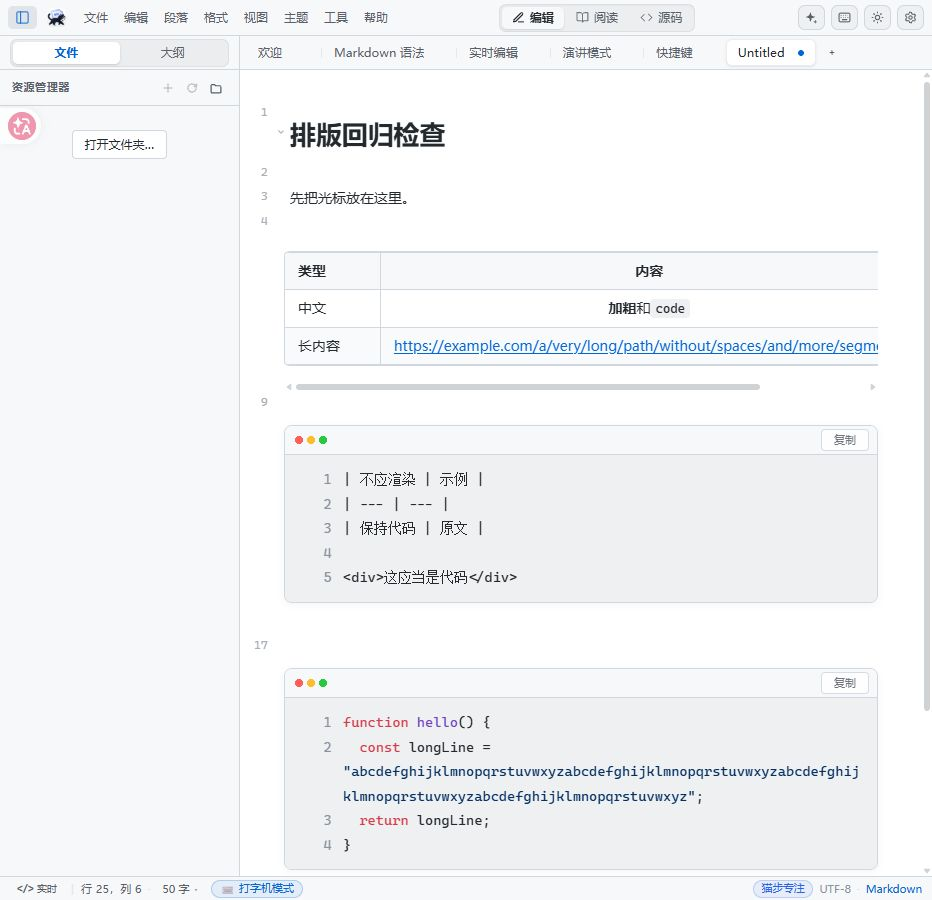
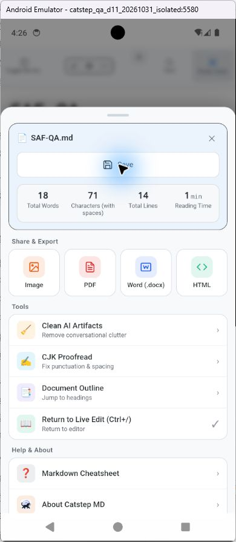

# 猫步 MD 修复实施与验收报告

日期：2026-10-31  
分支：codex/audit-remediation  
原始基线：4a980caedd5fb1fa5e73069c772ab4b8e51aeeb8  
配套报告：[深度检查与修改建议报告](深度检查与修改建议报告.md)

## 当前结论

原报告的 27 个问题逐条保留并落实对应修改，另补充 Pandoc 相对资源问题 B08、Android 发布产物命名覆盖问题 B09、移动端缺少直接触屏保存入口 D13/P1，实施矩阵共 30 项。交叉复查还补上保存并发、输入法、恢复快照、表格冻结时序和快捷键上下文保护。这里的“落实修改”表示已有产品实现及对应回归，不等同于所有平台、所有交互均已验收。

当前前端 **654/654** 及类型、国际化等配套门禁通过，Vite 生产构建 **17.76 秒**；正常配置完整 Rust 为 **699 通过、0 失败、4 项既有忽略**，全目标 Clippy 与独立 MCP crate **41/41** 通过。此前 Windows 凭据错误已用原生容量对照实验定位，受限回收本轮任务的测试残留后，加密相关原失败与最终完整测试均通过。官方便携 Pandoc 3.13 的真实导出核心 5 例及 EPUB/ODT 资源封装也已验证。

本轮已知缺陷修复及限定场景验收完成。Windows隔离审计入口已取得真实中文IME单次保存、文件监控、多窗口顺序通知/关闭订阅、冲突选择、650光标恢复和表格/代码宽屏交互证据。Android654 APK已实际通过触屏Save、已有工作区内dirty草稿取消picker后保留、再次保存，以及整个QA设备无快照冷启动后的授权/列表保留、从tree重开读取和追加保存。英文帮助键也已确认正确。结论以本报告列出的版本、fixture与动作范围为限，验收边界和后续专项另列。

修改位于工作区，尚未提交 commit。既有的 pdf-export.ts 修改和“一键启动.bat”删除均保持原样。

## 表格与代码的修改

表格、普通代码块共用 Markdown 块级解析规则。普通围栏、长围栏、缩进代码、引用内代码和未闭合围栏中的示例不再被二次解释为表格或 HTML；公式引用及自动编号预处理同样避开代码。

表格单元格和工具栏每次写入都从当前文档确认真实范围和模型，避免表格前插文字、输入后点工具栏时使用旧位置或旧正文。最终交叉复查还发现：Windows 输入保护的短暂冻结期间，装饰范围已经映射，但 widget 值没有重建。对此追加了当前装饰范围定位，回归覆盖“前插文字→改单元格→居中→继续输入”。

表格现在有局部横向滚动边界，阅读模式的滚动区域可用键盘聚焦；长 URL 不再撑宽全文，也不通过把所有列挤窄来隐藏内容。普通代码在非选中状态下整块显示，代码块内独立滚动；点击进入原有 CodeMirror 源码和撤销历史。正文换行、代码换行和代码行号分别生效。代码渲染不再给空行注入一个空格，保留复制内容中的真实空白。

### 界面复核截图

下图为 Windows 原生 650 前端的阅读模式：表格保留局部横向滚动，代码内的表格与 HTML 示例仍按原文显示。末列可达和代码点击/撤销另有后文的原生结果文件验证。

下图为 production 浏览器中的代码换行、行号组合；其他组合及宽窄视口的逐项观察保留在对应 JSON 中，不能用单张截图替代整个矩阵。

安卓 654 新增的触屏 Save 完成实际写盘后，文件名旁未保存标记消失；后文记录122/150/172字节的完整原文比对和冷启动流程。

## 逐项修改与证据

下表保留原报告 27 项编号，追加 B08、B09、D13 后共 30 项。源码路径均相对于项目根目录；回归文件指正式产品测试，旧的缺陷复现脚本保留为修改前证据。

| 编号 | 已落实修改 | 主要实现位置 | 回归依据 |
| --- | --- | --- | --- |
| D01 | 保存固定正文、路径、编码和 BOM 快照；成功只更新实际落盘版本；保存后再次同步尾部输入 | app/src/composables/useFiles.ts、app/src/stores/tabs.ts | note-lifecycle.test.ts 保存中继续输入与并发保存 |
| D02 | 属性以当前未保存正文为输入做局部变换，通过统一保存流程落盘 | app/src/composables/useProperties.ts、app/src/lib/frontmatter-property.ts | note-lifecycle.test.ts 未保存正文保留 |
| D03 | 属性异步流程绑定原标签身份，不向后来激活的标签应用全文 | app/src/composables/useProperties.ts | note-lifecycle.test.ts A/B 标签与延迟响应 |
| D04 | 文件读取、冲突选择返回后重新检查身份、正文与保存基线，并同步最后输入 | app/src/composables/useFileWatcher.ts、app/src/lib/file-conflicts.ts | note-lifecycle.test.ts 读取和对话期间输入 |
| D05 | UTF-16 显式按 LE/BE 写字节、保留 BOM；拒绝无法表示的编码；属性与附件引用重写也保留编码 | app/src-tauri/src/commands.rs | encoding_write_test.rs、note_write_conflict_test.rs |
| D06 | 启动和工作区恢复按磁盘版本协调；旧缓存不直接作为干净正文覆盖磁盘；恢复副本按实际写入快照记账 | app/src/stores/tabs.ts、app/src/composables/useFileWatcher.ts、useRecovery.ts | note-lifecycle.test.ts、recovery-orchestration.test.ts 的恢复、快照写入中继续输入及清理时序 |
| D07 | 重命名或移动目录迁移所有子标签、MRU/MFU；相关路径排队；干净文件重读带版本保护 | app/src/components/FileTree.vue、app/src/stores/tabs.ts | note-lifecycle.test.ts 子路径迁移；Rust 重命名与写入协调 |
| D08 | goal_set_at 在保存快照形成前加入，内存和磁盘对应同一版本 | app/src/composables/useFiles.ts、useWritingGoals.ts | note-lifecycle.test.ts 保存正文与日期一致 |
| D09 | 失焦先同步编辑器再检查脏状态；同步绑定实际渲染标签；保存和关闭等待组合输入结束 | app/src/components/Editor.vue、app/src/lib/editor-flush.ts、app/src/App.vue、useShortcuts.ts | editor-composition.test.ts、note-lifecycle.test.ts；648 原生微软拼音单次 Ctrl+S 等待提交 |
| D10 | Git 拉取后重新协调打开标签；移除固定 30 秒监控抑制 | app/src-tauri/src/github_sync.rs、app/src/composables/useFileWatcher.ts | note-lifecycle.test.ts remote-pulled 事件与版本保护 |
| D11 | SAF 选择、恢复和取消共用同一持久化状态键 | app/src/lib/saf-picker-state.ts、app/src/stores/workspace.ts | 模块回归；真实系统picker取消/重开/授权/新建；654既有工作区dirty取消保留、完整设备冷启动后授权/列表保留、从tree重读与追加保存通过 |
| D12 | 按窗口和路径别名独立订阅；保存只排除写入者的确切别名；字节摘要区分自写和紧随的外部写入 | app/src-tauri/src/watcher.rs、runner.rs、lib.rs | watcher 6 项测试，含真实 OS 原子替换事件 |
| D13（新增，P1） | 移动端更多菜单增加直接触屏Save，立即经Sheet→Toolbar→App进入既有saveActive；保存中/无文档禁用，清洁标签仍允许同步末尾输入；修正帮助/关于两个现有翻译键 | app/src/components/MobileActionSheet.vue、Toolbar.vue、app/src/App.vue | 实际SFC/Toolbar/App接线4/4与654门禁；真实654触屏保存122B、取消后保存150B、冷启动后读写172B均exact，成功后clean，英文帮助/关于正确 |
| M01 | 当前装饰范围定位与共享控制器同步，冻结期间也不使用旧偏移 | app/src/lib/cm-live-blocks.ts | markdown-live-integration.test.ts 原位偏移及 Windows 冻结场景 |
| M02 | 工具栏写前解析当前表格；编辑、对齐和继续输入共享最新模型；旧对话结果拒绝落盘 | app/src/composables/useEditorTable.ts、cm-live-blocks.ts | markdown-live-integration.test.ts 输入→工具栏→继续输入 |
| M03 | 普通代码块不参与表格和 HTML 的实时块渲染 | app/src/lib/markdown-structure.ts、cm-live-blocks.ts | markdown-live-integration.test.ts 代码内表格/HTML |
| M04 | 编辑与阅读使用一致的表格块语法和列归一化规则，支持无外管道、仅表头等合法形式 | app/src/lib/markdown-table.ts | markdown-live-integration.test.ts、多组现有 table 测试 |
| M05 | 引用表格列操作保留原引用前缀；导航跳过代码示例 | app/src/lib/markdown-table.ts | markdown-live-integration.test.ts 引用列操作 |
| M06 | 预处理只修改代码范围之外的正文，不改变合法代码围栏中的字节 | app/src/lib/markdown.ts、equations.ts、markdown-structure.ts | code-block-fidelity.test.ts、markdown-live-integration.test.ts |
| M07 | 正文宽度受视口约束，表格独立横向滚动；阅读视图添加可聚焦滚动区域 | app/src/lib/cm-layout.ts、markdown-layout.ts、app/src/styles/markdown-layout.css | 浏览器宽窄live/reading矩阵与650原生宽屏局部滚动、尾列、阅读图通过；原生窄屏/全设置组合未纳入本轮覆盖 |
| M08 | 代码块阅读容器独立滚动，默认 CodeMirror 路径接入代码换行与行号设置；点击按当前范围展开原源码 | app/src/lib/cm-code-block.ts、cm-ime-guard.ts、cm-live-render.ts、app/src/components/Editor.vue | 模块生命周期、浏览器设置组合、650原生字面代码/点击19:1/EnterUndoSave还原447字符fixture通过；不外推到未测组合 |
| B01 | DOCX 按单元格归并多段落，保留空格、换行、空单元格和矩形列结构 | app/src-tauri/src/convert.rs | convert::fidelity_tests |
| B02 | DOCX 每个 run 独立计算样式，识别显式关闭值，合并相邻同类样式 | app/src-tauri/src/convert.rs | convert::fidelity_tests |
| B03 | CSV、XLSX、DOCX 共用单元格转义，竖线和内部换行不再改变行列归属 | app/src-tauri/src/convert.rs | 真 CSV 与实际 XLSX ZIP 导入测试 |
| B04 | MCP 名称包含原名及配置摘要，避免清洗碰撞并拒绝重复声明 | app/src-tauri/src/mcp_client.rs | mcp_client_e2e_test.rs 真实本地假服务 |
| B05 | MCP 连接按完整配置摘要隔离；旧请求保持绑定原连接，新请求使用新配置 | app/src-tauri/src/mcp_client.rs | mcp_client_e2e_test.rs A/B 服务切换 |
| B06 | 初始化、发现、连接等待、调用和响应读取均有 deadline；取消清理 pending；SSE 匹配响应后完成 | app/src-tauri/src/mcp_client.rs | 假服务静默、取消、永不关闭 SSE、空结果测试 |
| B07 | 三种 provider 的工具执行共用本次请求 exact 允许名单与写权限/额度校验 | app/src-tauri/src/ai_proxy.rs、agent_tools.rs | agent_tool_authorization_test.rs 三 provider、9 场景及磁盘副作用检查 |
| B08（原候选） | Pandoc 明确传源目录与资源路径；相对 bib/csl/template 先解析授权；临时输入自动清理；Windows 非 UTF-8 失败诊断按系统代码页解码，保留中文路径 | app/src/composables/usePandocExport.ts、app/src-tauri/src/pandoc.rs | 假进程参数/清理与官方便携3.13真实核心驱动5例通过，EPUB/ODT图片及Bib/CSL封装、中文诊断已验；reader逐页视觉为后续专项 |
| B09（新增） | Android 按 output metadata 的 ABI filters 命名；核对版本、核心 ELF/ABI、完整 APK 集与唯一 AAB；全部通过后准备唯一公共文件，上传前完整复验 manifest，避免按 universal 目录误分类后同名覆盖 | scripts/lib/prepare_android_release.py、.github/workflows/release.yml | 真实 split 路径重放；离线 Python 19/19；独立代理 19/19 与只读复查；真实 650 debug 输出按预期拒绝作为完整 release 发布集 |

## 交叉复查中追加的保护

1. 保存增加后端按真实文件路径串行的比较后写入，拒绝两个窗口同时使用同一个旧基线覆盖彼此。Windows 使用系统 Ordinal 比较规则共享大小写别名的锁，而不只转换 ASCII。真实文件系统回归确认 Ä.md/ä.md 在本机是同文件，只允许一个新建成功；I.md/ı.md 在本机是不同文件，两者均可成功。前端预检之外仍有后端 CAS 检查；冲突返回不自动盲写。其互斥范围是本应用进程内的写入，独立外部程序不参加本应用的锁，不能据此宣称跨所有进程的文件系统事务。
2. 文件写入与目录重命名、删除使用树级协调。附件引用重写不重复取得树锁，避免读写锁重入死锁。文件 symlink 的原子保存写向链接目标，保留链接本身。
3. 中文输入法组合期间，同步协议明确返回 blocked；保存、关闭、外部读取协调等待结束。切页和卸载保留可见草稿，并释放等待者，避免把旧编辑器正文写到新标签。代码块点击进入源码也按映射后的当前位置定位；只有实际组合输入结束后，明确的展开动作才可结束短暂的输入静默期。编辑器在没有收到 compositionend 时销毁或重置状态，会清理自己持有的组合标志和计时器，不清除其他窗格的实际组合输入。
4. 保存基线比较统一 CRLF 和裸 CR；字面 U+FEFF 不重复当作编码元数据剥离。
5. 恢复快照按实际写入正文记账并排队，防止旧快照完成后把更新正文误记成已备份，也防止清理后晚到写入重新留下旧副本。
6. 修正测试随机 fixture 的密钥清理，使用内部原语或已授权自身 fixture 的受保护命令执行 RAII。原生同形 A/B 容量实验确认：持有 A 时 B 写入返回 error 8，只删除自己的 A 后，同一个 B 即可写入；不能简单归因于路径字符或目标长度。只读审核本轮任务开始时间、CreationTime、固定样本与文件 SHA 后，经授权仅清理本轮的 14 个精确随机目标，结果 11 删除、3 原已不存在。未枚举凭据、未读密码、未删目录，未清理任务开始前、未知或真实用户凭据，未改生产存储格式。最终完整测试新建的 6 个写 key fixture 均精确核验为 NoEntry 1168，证明 RAII 已回收。
7. 真实 Pandoc 失败路径实测暴露 Windows ACP936 stderr 中文乱码。诊断解码先保留合法 UTF-8，Windows 非 UTF-8 使用当前系统代码页转换，避免固定假设 GBK；未改变其他外部命令。真实中文缺失书目诊断、成功及失败临时文件清理均已复验。
8. 表格 Ctrl/Cmd+Shift+Z 曾同时重做并启动专注计时。默认计时快捷键现在在实际文字编辑目标让位历史操作，工具栏/非编辑区域保留原默认，显式用户自定义仍有效；CodeMirror 使用既有历史栈增加相同重做别名。原生复核又发现第一轮全局 IME early return 会吞掉 Ctrl+S；已将保护限于计时动作，只对实际绑定的 file.save 恢复 composing/Process/229 组合，继续进入原有组合输入等待机制，不需要第二次保存。真实 handler→saveActive→提交后续写回归与最终微软拼音单次 Ctrl+S 验收均通过；阶段回归和原生发现保留在 [快捷键专项记录](evidence/after-fixes/shortcut-conflict-followup.md)。
9. Android实际UI进一步暴露正常触屏写作缺少不关闭文档的Save入口：窄屏文件菜单不显示，原更多菜单与底部Dock也无保存，失焦自动保存默认关闭。关闭标签的未保存确认虽可间接保存，不能替代写作中的直接入口。新增按钮立即触发既有saveActive，不使用菜单原有120ms延迟，不另建保存队列、不开启默认autosave，也不自行markSaved或吞保存错误。按钮在保存中/无文档时禁用；清洁标签仍可触发编辑器同步，避免store滞后时拒绝最后输入。两个无效翻译键替换为既有menubar.mdHelp、menubar.about；菜单保持显示，让真实dirty与错误状态决定是否已保存。

## 验证结果

最终前端边界修复之后，完整前端测试为 **654/654 通过，0 失败、0 跳过**。测试类型检查、国际化键与 CJK 门禁、toast/confirm 字面量门禁均通过；Vite生产构建 **17.76 秒**，整条 `pnpm build` 含类型检查 **24.238 秒**。该计数新增D13四项，并包含表格/源码重做与计时隔离、单次IME保存续写、标签光标、恢复副本和代码生命周期。结果及耗时见 [最终门禁](evidence/after-fixes/gate-results-final.json)；完整日志为同目录的test-final.txt、test-type-final.txt、i18n-check-final.txt、i18n-toast-final.txt和build-final.txt。git diff --check通过。

D13定向 **4/4** 见 [组件接线日志](evidence/after-fixes/mobile-save-targeted.txt)，其类型检查见mobile-save-typecheck.txt。测试执行实际MobileActionSheet编译渲染、Toolbar/App模板中的事件/prop表达式与App真实pending处理，验证dirty Save立即进入既有服务、重复点击受限、无文档禁用、清洁标签可flush、切页不改首个请求、英文/中文现有翻译。随后真实654 APK触屏写盘、取消保留和冷启动读写也通过，见 [SAF实际结果](evidence/android-real/saf-ui-result.json)；组件与原生证据分别保留。

构建仍有既有的静态/动态混合导入提示，Mermaid、tldraw 等资源包体也较大。本轮没有进行启动性能、极大文档交互延迟或包体优化验收，构建成功不表示这些维护项已经解决。

最终后端完整门禁覆盖 Windows 非 ASCII 大小写路径锁、Pandoc 诊断修复以及测试凭据容量恢复后的产品源码，命令为 `cargo test --locked --offline -j2 --no-fail-fast -- --test-threads=2`。测试及 Clippy 子进程均无 `TAURI_CONFIG`，未修改父进程或系统环境。

后端已确认的结果：

- 最终完整应用 Rust：**699 通过、0 失败、4 项既有忽略**；其中 lib 272、desktop bin 284、24 个集成目标 143，doc-tests 0。lib/bin 有重复模块覆盖，699 是测试执行结果数，不代表独立功能数量。完整日志为 [最终正常配置 Rust 日志](evidence/backend-repro/app-rust-tests-final-normal-config.txt)，逐目标计数为 [精确统计](evidence/backend-repro/app-rust-tests-final-normal-config-counts.json)。
- 保存冲突专项 **7/7 通过**，并已包含于最终完整运行；覆盖 Unicode 别名并发新建、普通双窗口旧基线竞争、目标删除、UTF-16/CRLF/裸 CR 和附件重命名。独立日志为 cas-unicode-final.txt。
- 最终 all-targets Clippy 将 warnings 视为 errors 的检查通过，日志为 [正常配置 Clippy](evidence/backend-repro/app-clippy-final-normal-config.txt)。
- MCP 服务 crate **41/41 通过**；该独立 crate 源码此后未变，不重复计入应用 699 项。
- 官方便携 Pandoc 3.13 的真实产品导出核心驱动 **5/5 符合预期**，EPUB/ODT 相对图片、Bib/CSL、中文空格路径与包内资源一致性检查通过；修复后的中文错误诊断与临时文件清理通过。Pandoc 正式 lib/bin 各 6/6 已包含于最终完整测试，见 [真实 Pandoc 验收](evidence/pandoc-real/README.md)。这不代表原生文件选择流程或阅读器逐页视觉验收。
- B09 Android 发布 helper 的离线回归 **19/19、无跳过**，包含真实 universal 目录布局、空核心库、ELF/metadata ABI 不符、路径越界、重复公共名、多 AAB、篡改 manifest 与中文空格路径 CLI。独立代理再次执行同一组亦 19/19，不应相加为 38 个独立测试；见 [发布复核](evidence/android-real/release-helper-root-peer-review.json) 与 [Android 构建说明](evidence/android-real/README.md)。没有运行 gh、创建 release 或上传。
- Android654限定SAF实际验收通过：真实系统provider、直接触屏Save、dirty取消picker不写盘及保留草稿、完整设备冷启动后授权/列表/重读/追加保存；三次保存为122B、150B、172B且逐字节匹配预期UTF-8，见 [结果JSON](evidence/android-real/saf-ui-result.json) 和下节四份拉回的Markdown证据。
- 原先定向 28/28、较早完整测试及独立集成结果作为阶段证据保留，不与最终计数相加。较早完整单测曾为 lib269、bin280通过/1失败，旧独立集成为 142通过/1失败/4忽略；两项失败均为 Windows secure storage error 8，原日志 app-rust-tests-keyring-failure.txt、all-integrations-final.txt 和当时隔离失败 keyring-isolated-after-cleanup.txt 保持原样。后续受限恢复后，原失败分别 isolated 1/1，再由最终完整运行重新通过，没有忽略失败或绕过生产安全存储。

凭据调查与逐项清理见 [受限恢复结论](evidence/backend-repro/keyring-investigation/conclusion.md)。原生 API 的同形容量实验、仅本轮精确目标回收后的容量恢复，以及加密往返/双设备本地远端测试重新通过，构成此次恢复证据。没有枚举内部总条目或总占用，因此不声称测出 Windows 的具体内部限额。生产密钥命名、读取兼容与安全存储方式均未改变。

机器可读结果和完整输出位于 [后端验证汇总](evidence/backend-repro/validation-summary.json)、[后端专项说明](evidence/backend-repro/remediation.md)、[数据专项说明](evidence/data-repro/fix-validation.md) 及 evidence/after-fixes。

## 界面验收记录与限制

本轮已恢复并执行浏览器 production 与 Windows Tauri/WebView2 两组实际交互。两者分开记录，较早工具停止、修前冻结、首次 IME 保存失败等证据继续保留；旧的 native=false 或“未启动 GUI”准备文档不能覆盖后续已获得的实测结果。当前原生汇总见 [Windows 原生验收证据](evidence/native-isolation/acceptance-summary.md)。

原生使用独立审计 identifier `app.catstepmd.audit.r20261031n1`、新的 QA 文档与配置目录、正常桌面 runner 和进程级 keyring mock，前端来自 localhost。它不是正式安装包或 OS 沙箱。原生二进制没有随每次前端修复全部重编，因此逐项保留“该原生入口 + 当时前端”的身份：IME单次等待/切页为648，光标与表格/代码宽屏为650；这些不改标为当前654。其余未记录前端版本的较早截图不推定在后续版本重跑。

| 环境与实际场景 | 有证据支持的结果 | 主要证据 |
| --- | --- | --- |
| Windows 原生普通保存 | 中文、emoji、表格正文与代码空行/缩进实际落盘，快速输入后立即保存保留完整正文 | [保存结果](evidence/after-fixes/native-save-result.json) |
| Windows 原生 clean 外改与保存后快速外改 | 外改显示到原生窗口；宿主观察到自身保存后 1ms 再写的 marker 也显示，没有被旧时间窗口吞掉 | [时间记录](evidence/after-fixes/native-fast-external-change-result.json)、[显示截图](evidence/after-fixes/native-fast-external-change.png) |
| Windows 原生多窗顺序通知与关闭订阅 | 主窗保存后辅窗显示对应 marker；关闭辅窗后，主窗仍可收到后续外改 | [跨窗刷新](evidence/after-fixes/native-cross-window-save.png)、[关闭后主窗监控](evidence/after-fixes/native-watcher-after-second-close.png) |
| Windows 原生 dirty 冲突 | Escape 取消保留本地草稿/蓝点，磁盘仍为外部版本；再按 Ctrl+S 会重弹冲突，明确选择覆盖后本地草稿落盘、中文提交保留 | [取消断言](evidence/after-fixes/native-conflict-cancel-result.json)、[明确覆盖断言](evidence/after-fixes/native-conflict-overwrite-result.json) |
| Windows 原生微软拼音，648 | `ni'hao` 候选打开时只按一次 Ctrl+S，再 Space 提交；提交前不写半成品，提交后自动保存完整“你好”，没有第二次保存 | [单次保存结果](evidence/after-fixes/native-ime-wait-save-after-fix.json)、[真实候选框](evidence/after-fixes/native-ime-wait-composing.png) |
| Windows 原生提交后立即新标签，648；光标复核，650 | 已提交中文保留在原文件，新页正文为空；650 原文 33:15 → 空页 1:1 且计数0 → 返回原文33:15。648 暴露的旧状态栏问题由650三截图关闭 | [提交与切页](evidence/after-fixes/native-ime-switch-result.json)、[650光标结果](evidence/after-fixes/native-cursor-final-650-result.json) |
| Windows 原生表格与代码宽屏，650 | 表格局部横向滚动可见尾列；普通代码内Markdown/HTML保持字面；插右列3→4→Ctrl+Z回3→Ctrl+Shift+Z回4→最终Ctrl+Z回3，未启动计时 | [650原生结果与6图清单](evidence/after-fixes/native-markdown-layout-final-650-result.json)、[阅读模式图](evidence/after-fixes/native-markdown-reading-650.png) |
| Windows 原生代码点击与保存，650 | 点击第二个JS代码块实际定位19:1；Enter后撤销再保存，与447字符fixture完全一致。该次为1200×800窗口，不代表窄屏/四设置组合均验收 | [代码点击图](evidence/after-fixes/native-code-click-650.png)、[还原断言](evidence/after-fixes/native-markdown-layout-final-650-result.json) |
| Chrome production，650 | 表格插列后3列→撤销2列→Ctrl+Shift+Z重做3列；源码 marker 撤销消失、重做恢复；未启动专注计时 | [650重做结果](evidence/after-fixes/shortcut-redo-final-650-result.json)、[截图](evidence/after-fixes/table-redo-final-650.jpg) |

浏览器层另有表格前插文字→改单元格→居中→继续输入、Tab/Enter/源码/历史、宽窄live/reading局部滚动、代码换行/行号和点击撤销证据，见after-fixes的table-offset-toolbar-final-production.json、table-navigation-history-production-result.json、layout-production-results.json、code-settings-production-results.json、code-click-undo-production-result.json。原生650已补上述宽屏表格/代码及独立阅读图，但浏览器的宽窄/四设置组合不升级为WebView2全矩阵通过。

### Android 构建与新增发布修复

最终已构建、验包、安装并完成本轮实际UI验收的是 `CatstepMD-654-x86_64-debug.apk`，SHA256 **`22549a7f8d907577a10affb03f3a089e9ec59d9a91ad009774868d73c9b1271d`**。applicationId `app.catstepmd`、版本1.0.12、SDK、ZIP CRC、核心ELF/ABI与debug签名检查见 [Android构建说明](evidence/android-real/README.md)、[654验包](evidence/android-real/apk-verification-654.json)、[固定副本记录](evidence/android-real/retained-apk-654.json)。早期650 APK与哈希只作阶段证据，未用它代表D13修后产物。当前仍是单ABI debug包，不声称完成正式多ABI release或商店安装验收。

实际单目标构建额外产生了没有核心 `.so` 的 ARM split；所谓 universal 本次也只含 x86_64，不能用于证明完整多架构发布。这个观察实证暴露了旧上传脚本只看 universal 目录、将全部 split 改为同一公共文件名并 `--clobber` 的风险。B09已改为 metadata ABI命名及先完整校验后准备、复验manifest后上传；真实650 debug集按预期被完整release准备命令拒绝。离线19项及独立复查通过，但没有执行完整多ABI release编译、签名或真实上传；helper只验核心ELF头/ABI，未解析AAB protobuf包名版本，也不将网络上传声称为事务。

独立QA AVD为Android14/API34/AOSP/x86_64，未复用原有AVD的用户数据或账号，使用真实系统DocumentsProvider，无mock。实际UI由CUA操作；ADB只用于明确的QA设备安装、诊断、fixture目录和拉取文本，没有用adb input或UI注入。工作区为 `/sdcard/Documents/CatstepQA`，测试文件 `SAF-QA.md`。修前物理Ctrl+S在Qt模拟器中未落盘的现象保留，但不将其归因于已确定的产品快捷键错误；D13缺少明确触屏入口由源审和界面独立确认，修后通过按钮完成下列验收。

| 实际场景 | 磁盘与UI结果 | 证据 |
| --- | --- | --- |
| 初次picker取消、重开、授权子目录、产品文件树新建 | 取消后可再次打开真实picker，授权Documents/CatstepQA并新建SAF-QA.md；650升级654时草稿恢复 | [取消返回](evidence/after-fixes/android-saf-cancel-return.png)、[重开](evidence/after-fixes/android-saf-reopen-after-cancel.png)、[授权范围](evidence/after-fixes/android-saf-grant-scope.png)、[结果JSON](evidence/android-real/saf-ui-result.json) |
| 654直接触屏Save | Save按钮可见，英文帮助/关于不再显示原始key；完整中文、emoji、空格与换行写入122B UTF-8，随后clean | [保存后图](evidence/after-fixes/android-touch-save-after-654.png)、[首存文本122B](evidence/android-real/SAF-QA-first-save.md) |
| 已有工作区带dirty草稿再次打开picker，逐级Back直到真正取消返回 | 本地dirty草稿保留；磁盘仍为原122B，与首存逐字节相同；再触屏Save后150B exact且clean | [取消后dirty](evidence/after-fixes/android-saf-dirty-after-cancel-654.png)、[取消后磁盘122B](evidence/android-real/SAF-QA-after-picker-cancel.md)、[再保存150B](evidence/android-real/SAF-QA-after-cancel-save.md) |
| 完整QA设备退出后同AVD以-no-snapshot冷启动 | 旧qemu28856退出，新qemu5940冷启；工作区授权与列表仍在。关闭原Tab再从tree重开，实际provider读取150B；追加后触屏Save写入172B exact且clean | [冷启恢复](evidence/after-fixes/android-saf-cold-boot-restored-654.png)、[从tree重读](evidence/after-fixes/android-saf-cold-boot-reopened-read-654.png)、[冷启后保存](evidence/after-fixes/android-saf-cold-boot-save-654.png)、[最终文本172B](evidence/android-real/SAF-QA-cold-boot-save.md) |

上述结果由 [saf-ui-result.json](evidence/android-real/saf-ui-result.json) 汇总，覆盖本轮D11/D13要求的限定系统provider流程。它不将单设备、单provider及UTF-8成功外推为所有Android存储提供方或桌面保存能力。

### 验收边界与后续专项

以下范围未纳入本轮签收，不作为已完成结果；它们是后续专项范围，不改变上述已知缺陷与限定场景已经完成的交付状态。

- 两个原生窗口同一旧 baseline 同时保存、Unicode路径别名的原生竞赛、其他进程同时写入尚未实测；当前多窗证据是顺序通知/关闭订阅，CAS并发依据仍是Rust回归。1ms记录是宿主观察保存到外写的差值，不是任意调度或事件延迟保证。
- 微软拼音只覆盖已执行的候选→单次保存→提交、提交后立即新标签；其他输入法、compositioncancel、候选尚打开时关闭窗口/切工作区等原生矩阵未验收。
- 原生 UTF-16/BOM/CRLF往返、崩溃恢复、恢复失败重试、属性并发、目录迁移/删除、磁盘满与权限故障、冲突重新加载等完整流程未实测；模块和Rust结果各自保留证明范围。
- 原生审计使用mock凭据，未验正式安装包、系统keyring持久化/重启、外部客户端配置或默认关联。正常配置Rust中的随机真实凭据测试与其清理证据另列，不与此GUI隔离混同。
- Android仅为一台新建API34 AOSP x86_64模拟器，不是物理真机/OEM或云provider矩阵；未测撤权、只读/额度、中途写失败、SAF重命名/删除等。当前SAF路径为UTF-8，不宣称桌面Rust的编码/BOM、CAS或原子保存能力；未跑完整多ABI release、正式签名发布或商店安装。
- 原生650宽屏表格/代码已通过，浏览器宽窄及四设置组合也已有通过证据；原生窄屏/四组合未逐项执行，不能将两种环境互相替代。其他桌面/移动系统的完整原生流程属于后续专项。
- Pandoc实进程与EPUB/ODT资源封装已过，原生导出交互及EPUB阅读器、LibreOffice逐页视觉未验收；未将其扩大为PDF/全部排版通过。
- 未调用远程真实AI、云同步账号或外部真实MCP服务；本地假模型、Node MCP和file:// Git回归不能替代这些集成。4项需外部服务的既有忽略项继续保留。

## 复跑入口与交付

~~~powershell
cd app
pnpm test
pnpm run test:type
pnpm run i18n:check
pnpm run i18n:toast
pnpm build
cd src-tauri
cargo test --locked --offline -j2 --no-fail-fast -- --test-threads=2
cargo clippy --locked --offline -j2 --all-targets -- -D warnings
~~~

前端回归使用实际 composable、store、Markdown 及 CodeMirror 模块；异步数据测试通过可控 IPC Promise 制造读写交错；Editor 组合输入测试提取实际 SFC 函数，避免复制一份不同于产品的逻辑。后端使用实际文件字节、OS watcher、本地假 HTTP/MCP/子进程验证协议及副作用。每类测试的证明范围均以该入口为限。

本次交付包含30项已落实的产品/发布修改、正式回归、保留的修前失败与修后通过日志，以及Windows和Android限定场景的实际验收证据。本轮已知缺陷修复及限定场景验收完成；覆盖之外的provider、平台、故障注入和完整视觉矩阵按上述边界作为后续专项。

证据入口：[源码指纹](evidence/after-fixes/source-manifest.json)、[最终验证汇总](evidence/after-fixes/validation-summary.json)、[最终交叉复核](evidence/final-cross-review.md)、[Android实际验收说明](evidence/android-real/SAF实际验收.md)。本轮独立验收窗口与本地预览服务器均已关闭，原有AVD元数据和SDK程序哈希未变，QA数据与安装包保留在任务临时目录，见[环境收尾记录](evidence/android-real/environment-closeout.json)。
