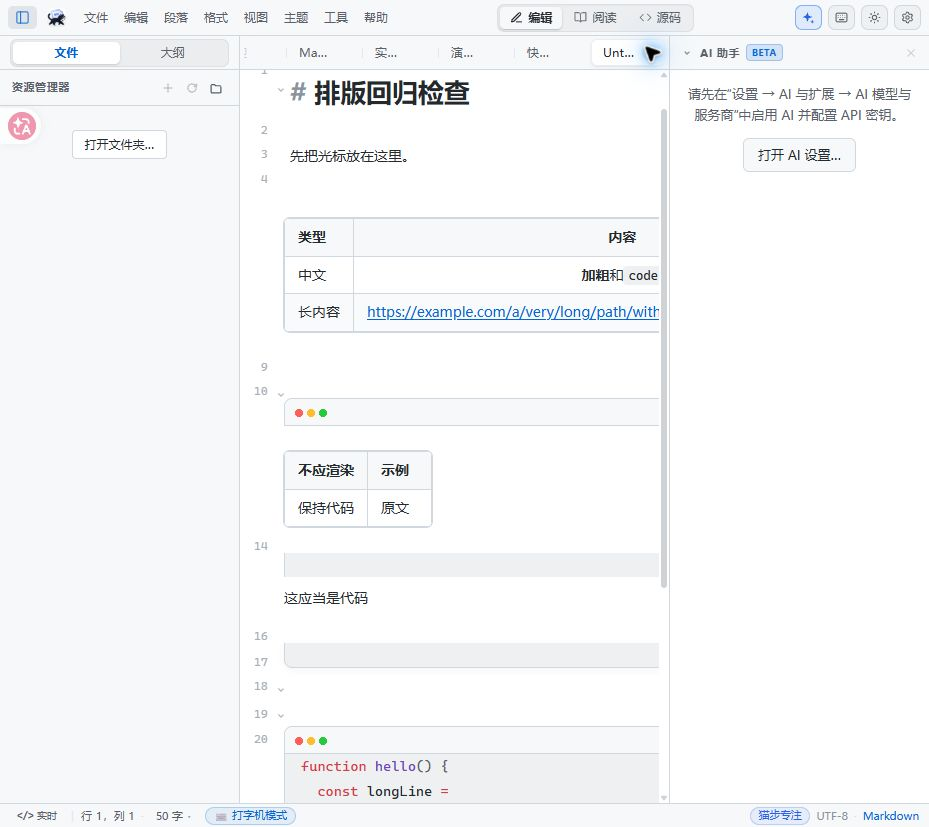
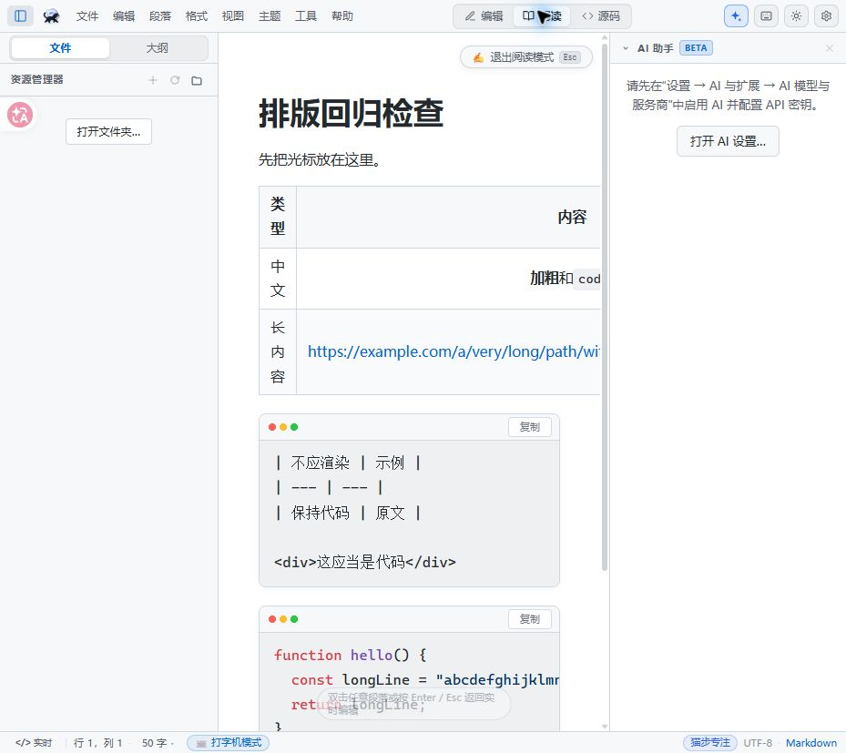
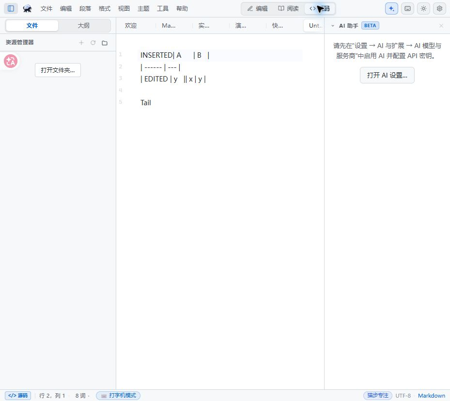
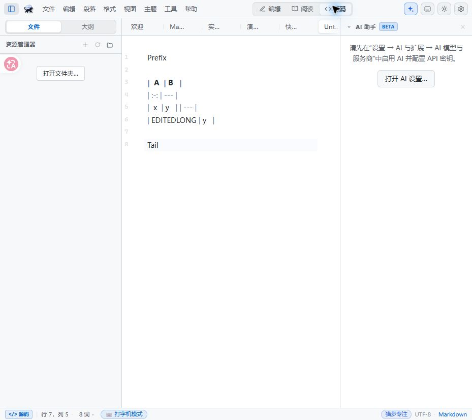

# 猫步 MD 深度检查与修改建议报告

审计日期：2026 年 10 月 31 日，Asia/Shanghai  
项目版本：1.0.12  
代码基线：4a980caedd5fb1fa5e73069c772ab4b8e51aeeb8 加当前工作区修改  
交付性质：问题诊断、修改方案与验收清单；本轮未实施产品代码修复

## 核心结论

本项目存在需要优先处理的数据一致性问题，也存在与你反馈直接对应的 Markdown 表格、代码显示缺陷。**表格问题同时涉及布局、解析规则和编辑写回，单独调整 CSS 无法解决全部问题。**

本次整理出 **27 项具体功能问题：12 项 P1，15 项 P2**。其中 **22 项有界面证据或可执行模块复现，5 项由完整源码控制流确认**。另外列出 Pandoc 相对资源解析这一项待验证候选，以及翻译、文档和测试体系方面的质量债务，不混入上述数量。

最需要先修的是：保存期间输入被误标为已保存、属性编辑丢稿或串标签、外部刷新覆盖新输入、UTF-16 编码写坏、恢复旧缓存，以及表格组件用过期范围或工具栏快照覆盖正文。它们会让“界面显示已保存”与“磁盘真正保存的内容”不一致。

现有 558 项前端测试、类型检查和生产构建均通过。这说明构建链路可用，但当前测试主要覆盖局部函数，未充分覆盖编辑器事件、异步返回、磁盘版本与多窗口的组合。

## 检查范围与证据口径

重点检查了默认 CodeMirror 编辑器、阅读预览、Markdown 预处理、表格模型及工具栏、代码块、保存与另存为、属性、文件监控、会话恢复、目录操作、Git 更新通知、编码转换、DOCX/CSV 导入、Agent 工具执行和 MCP 客户端。也运行了网页剪藏的 Markdown 测试和类型检查。

Windows 当前默认走 CodeMirror。app/src/lib/platform.ts:97 的函数只在 URL 含 forcePlain 时启用旧 textarea 路径；Editor.vue 中仍留有“Windows 默认 textarea”的旧注释，不能据此判断本次问题的适用平台。

| 证据类型 | 本报告含义 | 实际边界 |
| --- | --- | --- |
| 界面实测 | 在本地 Vite 应用中输入样本，检查 DOM、尺寸和截图 | Chrome 下的真实前端；不是已打包 Tauri/WebView2 的完整测试 |
| 模块复现 | 运行实际源模块，或抽取原 Rust 函数，控制事件与时序 | IPC、部分 DOM/Pinia 依赖使用最小替身；不等同于桌面端全流程 |
| 源码确认 | 追踪入口、调用方、异步返回和事件接收方，确认缺少保护或键不匹配 | 尚需双窗口、Android 或假模型端到端回归 |
| 待验证 | 有明确风险路径，但缺少运行条件或最终行为验证 | 不计入 27 项问题 |

P1 表示可能丢稿、错写、破坏文件，或阻断受支持平台核心操作，应优先修复；P2 表示明确的显示、转换或操作错误，应在近期修复。本次不作缺乏证据的 P0 定级。

现有工作区中 app/src/lib/pdf-export.ts 的修改和“一键启动.bat”的删除均保留。审计只新增本目录报告与证据，没有改写用户笔记、调用真实 AI 服务或执行远端同步。

## 问题总表

| 编号 | 优先级 | 问题 | 证据 |
| --- | --- | --- | --- |
| D01 | P1 | 保存期间的新输入被误标为已保存 | 模块复现 |
| D02 | P1 | 修改属性覆盖未保存正文 | 模块复现与后端路径 |
| D03 | P1 | A 的属性响应覆盖当前 B 标签 | 模块复现 |
| D04 | P1 | 自动重载覆盖读取期间的新输入 | 模块复现 |
| D05 | P1 | UTF-16 写入错误及 BOM 丢失 | Rust 字节复现 |
| D06 | P1 | 会话恢复直接采用旧缓存正文 | 模块复现与启动路径 |
| D07 | P2 | 重命名或移动目录未迁移子文件标签路径 | 原函数复现 |
| D08 | P2 | goal_set_at 在保存后插入，内存与磁盘不一致 | 模块复现 |
| D09 | P2 | 开启失焦自动保存后，快速切走可能漏保存 | 模块复现 |
| D10 | P1 | Git 拉取屏蔽文件事件后没有刷新打开标签 | 源码确认 |
| D11 | P1 | Android SAF 选择目录的状态键不匹配 | 源码确认，仅 Android |
| D12 | P1 | 多窗口保存事件被全局抑制且监控没有订阅计数 | 源码确认 |
| M01 | P1 | 表格位置变化后，旧事件闭包覆盖错误正文范围 | 界面与模块复现 |
| M02 | P1 | 输入后操作表格工具栏，旧快照覆盖新内容 | 界面与模块复现 |
| M03 | P2 | 普通代码块内的表格和 HTML 被再次渲染 | 界面与模块复现 |
| M04 | P2 | 实时编辑和阅读支持的表格语法、列数不一致 | 模块复现 |
| M05 | P2 | 引用表格的列操作丢失引用前缀 | 原函数复现 |
| M06 | P2 | 合法缩进代码围栏中的 HTML 被预处理改写 | 原函数复现 |
| M07 | P2 | 长内容表格撑宽编辑器，在阅读视图中挤排并裁切 | 界面尺寸与截图 |
| M08 | P2 | 代码块换行开关没有接通默认 CodeMirror 路径 | 源码确认 |
| B01 | P2 | DOCX 单元格内多段落被误拆成多列 | Rust 原函数复现 |
| B02 | P2 | DOCX 粗体和斜体状态泄漏到后续普通文本 | Rust 原函数复现 |
| B03 | P2 | CSV/XLSX 导入未转义竖线与单元格换行 | CSV 复现，XLSX 同类代码 |
| B04 | P2 | MCP 名称清洗碰撞，可能调用另一个工具 | 实际模块与本地假服务 |
| B05 | P2 | 修改 MCP 配置后仍复用旧连接 | 实际模块与本地假服务 |
| B06 | P2 | MCP 初始化和工具发现可无限挂起 | 实际模块与本地假服务 |
| B07 | P1 | Agent 执行层没有校验本次请求允许的工具 | 源码确认 |

## 表格与代码显示问题

### M07 长内容表格缺少受约束的布局与局部滚动

**这是与你反馈最直接对应的显示问题。** 样本包含中文列名、对齐标记、行内代码和一个不含空格的长 URL。编辑区域宽约 429px，可用滚动区宽 419px，但表格宽 671.34px，整篇 cm-content 被撑到 759.34px。表格影响了全文宽度，右侧内容离开可见范围。

阅读模式下，同一表格宽约 700.78px，容器可用宽仍为 419px；第一列被压到约 40.73px，中文逐字换行。preview-host 的 overflow-x 为 hidden，右侧列被裁切，缺少可见的表格局部横向滚动入口。

定位：app/src/lib/cm-live-blocks.ts:1496、1527，表格设置 width: max-content、单元格 minWidth: 64px，但外层没有可靠的宽度约束与局部横滚。app/src/components/Preview.vue:855 设置 overflow-x: hidden；1019 的表格规则没有补上局部滚动容器。

修改方案：编辑与阅读共用表格布局规则；用受父级宽度约束的 wrapper 承担横向滚动，宽表只滚动表格，避免撑宽全文。为中文列设置合理的可读宽度，对 URL、哈希和行内代码规定换行策略；避免通过缩小所有列宽来强行塞下宽表。

验收：窄窗、双侧栏、分栏和手机宽度下，最后一列始终能访问；表格不扩大全文滚动宽度；中文短标签不被挤成逐字竖排。对 2、6、12 列，长 URL、长代码和空单元格分别截图回归。

### M03 普通代码示例被二次解释为表格和 HTML

触发：在普通 markdown 语言代码围栏中放三行管道表格，以及一行 div 示例。编辑模式会显示一个可交互表格和普通 HTML 正文；阅读模式则仍将它们展示为代码字符，两个视图语义不一致。

定位：app/src/lib/cm-live-blocks.ts:1034 起按全文逐行扫描，后续图片、HTML、公式与表格识别没有统一排除普通代码范围。另一条 cm-live-render 语法树链路识别了 FencedCode，也不能保护这个独立 StateField。

修改方案：块级装饰使用统一的语法范围，排除 FencedCode、CodeBlock 和容器中的代码；只在对应 fence token 上启用 Mermaid、PlantUML、tldraw。不能用“遇见像表格的几行就替换”的全文启发式扫描。

验收：代码内表格、HTML、图片、公式均保持原字符；三/四反引号、波浪线、未闭合围栏以及引用和列表内代码都覆盖。已证实的是显示失真；代码内生成 widget 后的进一步写入风险不作为已完成的用户操作复现。

### M01 表格前编辑文字后再改单元格可能覆盖正文

定位：app/src/lib/cm-live-blocks.ts:287 将 source、模型、blockFrom/blockTo 捕获到局部闭包，385 的输入处理用该范围写回。539 的 updateDOM 重用旧单元格时只更新 DOM 和 widget 指针，未更新旧事件闭包的数据。

触发：文档包含 Prefix、两列表格和 Tail；在表格前插入 INSERTED，再改单元格 x。模块及真实浏览器操作均确认 Prefix 丢失，结果出现 INSERTED 紧接表头及重复表格残行。破坏的是编辑器文档，保存会把错误持久化。

修改方案：让 DOM 事件读取可更新的表格控制器，updateDOM 原子更新模型、当前范围和原文。写入前核对当前 slice；对已发生位置或结构变化的表格重新定位。临时改为重建 widget 也必须验证焦点、中文输入法及撤销历史。

验收：表格前增删文本、两张表互相挤动、撤销后再编辑，表格外正文逐字符不变。除最小 DOM 探针外，已经在应用的真实浏览器 EditorView 中通过键盘前插文字和填写单元格复现；仍需原生 WebView2 和 IME 回归。

### M02 输入后操作工具栏会用旧快照覆盖新文字

定位：app/src/lib/cm-live-blocks.ts:415 仅在 focus 时发送 source 与 blockTo；385 的输入后未刷新工具栏快照。app/src/composables/useEditorTable.ts:197 读取旧 source，254 按旧范围整块替换。完整表格编辑器也复用相同快照。

触发：聚焦 x，输入 EDITEDLONG，然后点居中。模块和真实浏览器中均确认源码内单元格变回 x，文档尾留下 EDITEDLONG 和重复残行。工具栏的 mousedown.prevent 保持焦点，因此不能指望 blur/refocus 自动刷新数据；活动格的 DOM 还可能暂时保留新字，切到源码才看见损坏。

修改方案：工具栏仅保存表格身份和目标行列，执行时从当前文档重新定位和解析；或维护每次输入都更新的控制器及版本。不能将 focus 时的全文快照当作之后操作的真实来源。

验收：输入后立刻进行对齐、增删行列、移动列、打开完整编辑器等操作，新文字必须保留；内容长度增减和中文输入均覆盖。验证边界与 M01 相同。

### M04 同一 Markdown 在编辑和阅读中有不同表格结构

定位：app/src/lib/cm-live-blocks.ts:121 的识别要求两侧外管道、部分分隔符至少三个横线，1285 还要求正文行；app/src/lib/markdown-table.ts:131 取表头与分隔行列数最大值，阅读预处理则按表头列数纠错。

已复现：无外侧管道、只有表头的空表、单横杠分隔、引用表格都能在阅读中生成 table，但默认 live widget 不识别。两列表头加三列分隔行，在阅读中为两列，在实时编辑中成为三列，编辑后还可能写回额外空列。

修改方案：统一表格范围、分隔符容错、列数和容器前缀策略；编辑与阅读共享同一套表格结构判断，保证序列化后仍与展示一致。

验收：以上各形态在实时、源码、阅读和保存重开后列数、内容一致；对转义竖线、代码内竖线、中文和对齐标记增加交叉矩阵。

### M05 引用表格的列操作丢失引用前缀

定位：app/src/lib/markdown-table.ts:239、255、269。insertColumn、deleteColumn、moveColumn 返回的新模型未保留 prefix。

触发：每行以“> ”开头的表格，插入、删除或移动一列后重新序列化。所有行失去引用前缀，表格从引用容器中移出。

修改方案：返回新模型时保留原模型附属字段，行列操作采用一致的不可变更新约定。验收应逐项检查所有结构操作的容器前缀，而非只测试单元格值。

### M06 渲染前的 HTML 修正会改变合法代码内容

定位：app/src/lib/markdown.ts:475 的 FENCE_RE 只保护零缩进、三字符围栏。两空格缩进的合法 html 围栏未被保护，内部四空格的 div 示例被去掉缩进并加入额外空行。

影响阅读和共用预处理的导出、复制保真；这一步本身不改磁盘源码。

修改方案：所有预处理共享符合围栏缩进、长度和容器规则的代码保护范围，仅在非代码区域做 HTML 修正。验收必须比对代码的缩进和空行，而非只断言某段文字存在。

### M08 代码块换行选项没有作用于默认编辑器

定位：app/src/components/Editor.vue:4287 根据设置挂上 cb-wrap-on，但 5093 的换行 CSS 只选中旧 plain-block 路径；默认 CodeMirror 使用 cm-md-fenced-line，由 cm-live-render.ts:1000 附近的逐行样式呈现。Editor.vue:3509 则用全局 wordWrap 控制整个 CodeMirror。

源码确认：代码块专属换行选项改变了宿主类名，却没有相应的默认 CM 样式或扩展响应。普通正文换行与代码换行仍未独立。

修改方案：明确正文与代码两组换行策略并接入默认实现。如果要求代码块独立横滚，需要评估整块容器与 CodeMirror 文档光标、选区、IME 的兼容性，不能只给宿主增加一个类名。

验收：正文换行开/关 × 代码换行开/关四种组合，在实时、阅读、分栏中行为一致。此项尚未完成切换设置的桌面动态验证。

## 保存 文件与数据一致性

### D01 保存返回时错误清除后续输入的脏标记

定位：app/src/composables/useFiles.ts:672、734；app/src/stores/tabs.ts:285。

保存捕获 v1 写入磁盘，await 期间用户输入得到 v2；返回后 markSaved 却用当前 v2 更新 savedContent。实测捕获的磁盘 payload 是 v1，而 dirty=false、savedContent=v2。关闭时可能不再提示，后续恢复清理也会误认内容已保存。

修改方案：保存前捕获 tabId、path、revision、正文和编码的不可变快照；成功只登记这一快照，v2 保持 dirty。对同一文件串行写入或处理版本顺序，防止旧写入最后完成。

验收：慢写入期间输入、连续保存、另存为时切换标签，重读磁盘与 savedContent 必须对应同一版本。

### D02 修改属性覆盖未保存正文

定位：app/src/composables/useProperties.ts:78、98、118；app/src-tauri/src/commands.rs:1636、1671。

后端从磁盘旧正文修改 YAML，再把整篇结果返回；前端无条件替换当前正文并标记已保存。正文含 UNSAVED EDIT 时直接改属性，这段未保存文字会消失。

修改方案：在最新编辑缓冲上修改 frontmatter 并保留 undo，再走统一保存管道；后端需要处理时传内容与版本，返回局部 patch。验收覆盖脏正文、尚在 debounce 内的输入、连续属性操作及失败返回。

### D03 A 的异步属性响应污染 B 标签

定位：app/src/composables/useProperties.ts:78、85、112。

在 A 发起属性更新后切换 B，响应完成时 applyRewritten 读取的是此刻 tabs.activeId。复现中 B 的未保存内容被 A 全文替换，B 同时变为 clean；后续保存可写错 B 文件。

修改方案：跨 await 保留 tabId、path 和 revision，按请求发起对象回写并校验身份；原标签关闭、重命名后不能转写其他标签。验收检查 B 的正文、路径、savedContent、undo 均不变化。

### D04 外部文件自动刷新存在读取竞态

定位：app/src/composables/useFileWatcher.ts:49、78。

读前判断 clean，读取仍 pending 时用户输入；返回后无条件 setContent 和 savedContent，新输入被静默覆盖。自动重载分支还缺少请求世代控制，连续事件可能乱序返回。

修改方案：记录请求 generation、tab/path 和开始 revision，返回时复核；仅在仍 clean 且版本未变时应用，否则保留 live 内容并进入冲突处理。验收覆盖慢读期间输入、连续外部修改、读时关闭与重命名。

### D05 UTF-16 与 BOM 写入不正确

定位：app/src-tauri/src/commands.rs:548、855；app/src/lib/commands.ts:49、102。

实际使用锁定的 encoding_rs 0.8.35 进行字节验证：请求 UTF-16LE 时，Encoding::encode 实际输出 UTF-8，普通保存会转换文件编码但标签仍保留 UTF-16 信息。atomic_write_encoded 又按请求加 UTF-16 BOM，形成“UTF-16 BOM + UTF-8 正文”，中文重读成为乱码。普通 UTF-8 BOM 保存也会丢 BOM，因为写入接口未传 hadBom。

修改方案：UTF-16LE/BE 明确使用 encode_utf16 并按端序输出字节；统一正文、BOM、换行的写入接口，处理编码器实际输出信息。不能通过更换文件扩展名或保留旧编码标签解决。

验收：UTF-8 有/无 BOM、UTF-16LE/BE、中文、emoji、ASCII，覆盖普通保存、另存为和属性变更；逐字节核对 BOM 和实际编码，并重读逐字符比对。

### D06 会话恢复将旧缓存当作当前磁盘版本

定位：app/src/stores/tabs.ts:135、213、438；app/src/App.vue:1370；app/src/composables/useFileWatcher.ts:18。

clean 标签被持久化后，应用关闭期间文件被外部修改。store 恢复仍采用缓存的旧 content/savedContent，且 dirty=false；启动后才注册的 watcher 不会补发关闭期间的历史变化。已有路径再次打开也可能直接返回原标签。

修改方案：clean 缓存只恢复位置等状态，正文重新读盘；dirty 草稿保留并比较旧 savedContent 与当前磁盘，双端修改时保留两份、提示合并。工作区切回使用同一协调流程。

验收：关闭期间改文或删文、非活动工作区改文、clean/dirty 两种缓存状态。现有复现验证了实际 store hydration 与启动路径，尚未完成关闭重开 GUI 测试。

### D07 目录变更后已打开子笔记仍指向旧路径

定位：app/src/components/FileTree.vue:725、858、943。

repointOpenTabs 只找 filePath 与目录原路径完全相同的标签，不处理目录下子路径。old/note.md 在 old→new 后仍指向 old/note.md，保存可能失败，旧目录重建时还可能出现分叉副本。

修改方案：按规范化目录边界迁移全部子标签，同时迁移 watcher、最近文件和恢复记录，保留 dirty 内容。验收覆盖多层目录、多个 clean/dirty 标签、目录移动与大小写变化。

### D08 保存后插入目标日期造成伪一致

定位：app/src/stores/tabs.ts:301；app/src/composables/useFiles.ts:672。

含 goal 且没有 goal_set_at 的笔记，先落盘，再由 markSaved 插入日期。磁盘无该字段，内存和 savedContent 却有，dirty=false。重开后目标日期会丢失或重新生成。

修改方案：保存前完成确定性内容变换，markSaved 只登记落盘快照。验收第一次保存后立即从另一 reader 读盘，内容应与编辑器一致，重复保存幂等。

### D09 失焦保存检查了尚未同步的旧 dirty 状态

定位：app/src/composables/useFiles.ts:779；app/src/components/Editor.vue:305；app/src/App.vue:1348。

仅在开启 autoSaveOnBlur 时适用，**该选项默认关闭**。clean 文档输入后 350ms 内切走，store 仍 clean，autoSaveDirtyTabs 在进入 saveTab 的 flush 之前就跳过了保存。之后 debounce 虽能更新内存，失焦事件却已结束。

修改方案：入口先 flush 编辑缓冲，再枚举 dirty；组合输入未结束时在结束后重试。验收 0/100/349/351ms 后切走，核对磁盘实际内容。

### D10 Git 拉取完成后打开标签没有重新协调内容

定位：app/src-tauri/src/github_sync.rs:1247；app/src-tauri/src/watcher.rs:198；app/src/composables/useGithubSync.ts:157；app/src/App.vue:866。

源码确认：pull 前抑制工作区 watcher 30 秒；remote-pulled 事件只触发索引与文件树刷新，没有重新读取打开标签。clean 旧副本可能继续显示并在保存时覆盖拉取结果，dirty 标签也缺少对新磁盘基线的协调。

修改方案：pull 返回 changed/deleted paths；clean 标签重读，dirty 标签保留输入并提示冲突。事件抑制与实际写入期绑定，完成或失败显式结束。

验收需要本地双仓库加桌面流程；本轮未运行真实远端拉取，不将此项表述为已在 GUI 复现。

### D11 Android SAF 目录选择结果无法进入解析分支

定位：app/src/composables/useFiles.ts:590 写 catstep:saf-picking，app/src/App.vue:1394 却读 solomd:saf-picking。

源码确认：正常入口写入的键无法满足恢复函数的检查，系统选择器返回后会提前 return。适用于该 Android SAF 选择流程，Windows 不受影响。

修改方案：共用一个持久化键常量，并兼容清理旧键。验收覆盖启动选择器、返回前台、解析目录、设置工作区、取消与重试；需要 Android 真机验证。

### D12 多窗口文件监控的生命周期和通知范围错误

定位：app/src-tauri/src/runner.rs:850；app/src-tauri/src/watcher.rs:29、189、230、288。

源码确认两条路径：其一，SELF_WRITES 在向全部窗口发送事件前全局抑制来源，A 保存后 B 无法得知同文件更新；其二，重复 watch 不记录窗口订阅，任一窗口 unwatch 会移除公共监控，另一窗口仍误以为监控存在。

修改方案：按窗口或订阅 token 记录引用关系；最后订阅解除时才移除系统监控。内部保存向其他窗口发带来源、路径和版本的内容更新事件，仅来源窗口去重。

验收：两个真实窗口打开同文件，A 保存→B clean 更新或 dirty 冲突；关闭 A 后 B 仍收到外部变化。本轮为源码确认，未运行双窗口 GUI。

## 导入转换 Agent 与 MCP

### B01 DOCX 把单元格内多段落误当成多列

定位：app/src-tauri/src/convert.rs:164、180。

两列表格第一格含 A1/A2 两段，第二格为 B，导入输出却成为三列 A1/A2/B。根因是在段落结束时 push 单元格，而非在单元格结束时提交。

修改方案：维护 cell buffer，段落结束只累计，遇到 w:tc 结束才提交；单元格内换行用受控表示。验收多段落、空单元格、列跨度和每行列数一致性。

### B02 DOCX 样式跨 run 泄漏

定位：app/src-tauri/src/convert.rs:106、133、162。

标准自闭合 w:b 元素不会产生对应关闭事件，run 结束也未清理。粗体 Bold 后的普通 Plain 仍被包成粗体；w:val=0 也可能错误启用样式。

修改方案：在 run 边界重置并解析 properties，收集完整 run 后统一包装 Markdown。验收粗体→普通→斜体、显式关闭样式、拆分文本节点与跨段落。

### B03 表格导入没有序列化特殊单元格内容

定位：app/src-tauri/src/convert.rs:296、309，XLSX 在 338；DOCX 183 也直接 join。

CSV 值 a|b 被直接写入 Markdown，生成额外列；引号包裹的多行值直接打断表格行。CSV 已运行复现，XLSX 的同类输出代码已确认，未宣称已运行 XLSX 文件样例。

修改方案：所有转换复用同一个 cell serializer，统一处理反斜线、竖线、CR/LF；表头也要转义。验收对转换后 Markdown 再解析，校验原记录数、列数与单元格文字。

### B04 MCP 名称清洗碰撞导致错误路由

定位：app/src-tauri/src/mcp_client.rs:112、135、803。

本地假服务同时提供 read.note 与 read_note，二者映射成同一个 mcp_audit_read_note，后写路由覆盖前写。调用第一个工具实际执行第二个；长名称截断也有同类风险。

修改方案：在模型可用名称中保留服务 ID 与原名的稳定短 hash，发布 schema 前检查唯一性；路由与当前请求绑定。验收标点、非 ASCII、超长名称及跨服务组合。

### B05 修改 MCP 配置仍复用旧进程和连接

定位：app/src-tauri/src/mcp_client.rs:716。

缓存只按 config.id 查找，连接存活即复用。相同 ID 从回复 A 的服务改为 B 后，重新列工具或调用仍返回 A；command、参数、URL、headers 和环境变更均需失效策略。

修改方案：保存连接配置 fingerprint，相关字段变化后有序关闭重连。验收更换命令、endpoint 与 token 后请求确实到达新服务，日志不打印秘密原文。

### B06 MCP 初始化和工具发现没有可取消的完成边界

定位：app/src-tauri/src/mcp_client.rs:222、241、784。

假服务存活但不回应 initialize 时，内部 rx.await 没有截止条件，测试在约 1.6 秒由外层 deadline 截断；源码还显示 tools/list 缺少相同保护。连接测试和 Agent 工具发现可能一直等待。

配置 timeout_secs 本来用于普通工具调用，此处的缺陷是初始化和发现缺少独立 deadline，不能将它泛称为所有阶段都违背该配置承诺。

修改方案：spawn、initialize、list、HTTP body 读取均施加可取消 deadline，超时清理 pending 与失效连接，聊天取消能够中断发现。验收永不回包、半条 JSON、list 挂起及取消后的 UI 恢复。

### B07 工具执行层缺少本次请求允许名单校验

定位：app/src-tauri/src/ai_proxy.rs:2723 的 schema 过滤；实际调度在 2436、3092、3701；app/src-tauri/src/agent_tools.rs:2889。

源码确认：allow_write 与 req.tools 主要用于决定向模型提供哪些 schema，三个 provider 的执行分支直接调度模型返回的工具名。dispatch 检查已知工具和 recipe quota，却没有本次请求的 exact allowlist 与写权限上下文。

触发条件需要异常或自定义模型返回未提供的工具、有效工作区和合法路径等。新文件 write_note 无需 overwrite，因此已有路径和覆盖检查不能代替请求授权校验。**本轮未完成假模型到桌面端的动态写入验证，不声称已经利用成功。**

修改方案：建立请求专属允许名单，每次 dispatch 复核 exact 名称、写权限和额度；未提供工具直接拒绝。选区编辑的产品特例需要限定明确作用范围。

验收：假模型强制返回未提供的写工具，文件保持不变并有明确拒绝结果；三个 provider 和自定义工具列表分别覆盖。

## 测试结果与当前质量边界

| 检查 | 结果 | 可支持的结论 |
| --- | --- | --- |
| app pnpm test | 558/558 通过 | 现有前端测试无失败 |
| app pnpm run test:type | 通过 | 测试与前端类型检查通过 |
| app pnpm run build | 通过，Vite 构建约 32.61 秒 | 当前前端可以构建 |
| app pnpm run i18n:check | 通过，存在已登记债务 | en/zh 键齐全，旧硬编码和其他语言缺项仍存在 |
| app pnpm run i18n:toast | 通过 | 现有 toast/confirm 字面量门禁通过 |
| web-clipper Markdown 测试与类型检查 | 通过 | 剪藏转换的现有回归通过 |
| mcp-server cargo test --locked --offline | 41/41 通过 | MCP 服务 crate 现有测试通过 |
| 双编译入口命令注册守卫 | 1/1 通过，独立 rustc 执行 | 本次未发现命令注册列表漂移 |
| 本次数据复现 | 8 个 TS 用例、3 个 Rust 字节断言确认缺陷 | 不是修复后的通过证明 |
| 本次 Markdown 复现 | 12 个探针确认缺陷 | 覆盖 6 类问题，包含最小 DOM 桩 |
| 本次后端复现 | 6 项确认缺陷 | 原转换函数及完整 MCP 客户端配合假服务 |
| Tauri 应用 cargo test --locked --offline | 671 passed、0 failed、4 ignored | lib/bin 存在大量重复覆盖，不代表 671 个独立功能；Windows 部分 Ollama e2e 被 cfg 排除 |

完整测试日志保存在 evidence/checks 和 evidence/backend-repro。前端构建包含当前已有 pdf-export.ts 工作区修改，不能把结果解释为纯 HEAD 的验证。

未执行的关键验收包括：原生 WebView2 中文输入法、打包应用完整操作、macOS/Linux、Android 真机、真实双窗口、真实 AI provider、远端 Git 同步、实际 Pandoc 导出、PDF/Word/图片的逐页视觉回归。官网与发布流程没有作为功能审计的重点，也没有作完整可用性结论。

### 待验证的 Pandoc 相对资源解析

app/src/composables/usePandocExport.ts:247 未传源文件目录，app/src-tauri/src/pandoc.rs:177 在临时目录写 Markdown，211 附近没有明确 current_dir 或 resource-path。文档相对图片可能丢失，需用已安装 Pandoc 的环境实际导出验证。本机未找到 Pandoc，因此不计入已确认问题。

### 国际化与维护方面的质量债务

i18n 检查显示 en/zh 各 2514 个键齐全；其余 12 个语言各缺 256 个键，覆盖率 89.8%，运行时回退英文。共有 3072 个缺项，另有 69 个文件中 1126 条已豁免的 CJK 硬编码。门禁通过表示未增加超出规则的债务，不代表所有语言体验完整。

编辑器存在默认 CodeMirror、旧 plain fallback、阅读预览和导出多条实现链，语法识别、样式与设置接线已经出现偏差。Editor.vue 和全局样式中同时保留历史覆盖规则，后续只在一条路径修补会继续产生模式不一致。

现有原子写入、legacy 编码不可表达字符拒绝、关闭前 flush、恢复确认和路径防护有实际价值；需要在其上补齐“文档身份、版本与磁盘结果一致”的系统约束。

## 建议的修改顺序

| 批次 | 范围 | 修改目标 | 必须达到的退出条件 |
| --- | --- | --- | --- |
| 第一批 | D01–D06、D08 | 统一保存快照、属性 patch、异步版本保护、恢复协调、编码写入 | 任意 await 期间输入都不丢，磁盘与保存基线一致，UTF-16 往返正确 |
| 第二批 | M01–M06 | 修复表格控制器和工具栏快照，统一代码保护与表格语法 | 表格操作不修改邻接正文，代码示例保真，模式结构一致 |
| 第三批 | M07–M08 | 统一表格宽度、局部滚动及正文/代码换行策略 | 窄窗不裁切，设置在默认编辑器生效，视觉矩阵通过 |
| 第四批 | D07、D09–D12 | 目录路径迁移、失焦保存、Git 与多窗口事件、Android 选择器 | 保存目标正确，多窗和拉取后内容协调，真机目录流程可用 |
| 第五批 | B01–B07 | 导入保真、MCP 命名/连接/deadline、执行层工具授权 | 特殊单元格不变形，无错误工具路由，异常模型不能超出本次允许工具 |

P1 的 B07 应与第一批并行处理，不必等待导入外观问题。第一批和第二批完成之前，不宜将表格编辑和自动保存的现有局部测试通过作为数据安全发布依据。

### 保存与编辑必须建立的共同约束

1. 每个异步操作绑定 tabId、规范化 path 和内容 revision，不能在返回时重新读取 activeId 决定目标。
2. savedContent 只能代表实际成功写入磁盘的那一版正文，任何保存后变换都不能伪装已落盘。
3. 所有文本写入经过同一条编码、BOM、换行和原子替换管道。
4. 文件事件、Git 拉取、会话恢复、多窗口更新都进行同一套 clean/dirty 与磁盘版本协调。
5. 表格工具栏在操作时读取最新模型与范围，写回前校验原文；结构变化与普通输入均纳入撤销事务。
6. 代码范围保护和表格语法判断在编辑、阅读、复制与导出之间共享规范。
7. 模型给出的工具名先经过当前请求允许名单验证，再进入具体工具执行函数。

### 修复后的必要回归

| 维度 | 最小场景 |
| --- | --- |
| Markdown | 外管道有无、空表、引用表、对齐、转义竖线、长 URL、代码内表格、缩进与长围栏 |
| 表格交互 | Tab/Shift+Tab/Enter、增删移动行列、输入后点工具栏、表格前增删字、撤销重做、中文 IME |
| 文件生命周期 | 编辑→慢保存→继续编辑→切换→关闭→重开；另存为、重命名目录、外部修改与删除 |
| 编码 | UTF-8 有/无 BOM、UTF-16LE/BE、CRLF/LF、中文与 emoji、属性变更 |
| 窗口与同步 | 两窗同文件、关闭其中一窗、clean/dirty 拉取、失败或慢拉取、工作区切回 |
| 视图与布局 | 实时/源码/阅读/分栏，浅深主题，419px 窄编辑区及宽窗，正文与代码换行四组合 |
| 导入与导出 | DOCX 多段落单元格、样式恢复、CSV/XLSX 特殊值，实际 PDF/Word/图片视觉核对 |
| Agent/MCP | 未提供工具、写权限关闭、名称碰撞、配置替换、无响应初始化与取消 |

## 证据文件与复跑

本目录的三个专项报告提供更细的原始位置、观察输出及验证边界：

- [数据与核心逻辑专项](evidence/data-repro/report.md)
- [Markdown 编辑与渲染专项](evidence/markdown-repro/findings.md)
- [后端 Agent 与转换专项](evidence/backend-repro/findings.md)
- [界面测量与样本](evidence/ui-observations.json)
- [前端与剪藏检查日志](evidence/checks/)

主报告将 M03 按已证实的显示失真定为 P2；Markdown 专项原始记录曾标 P1，最终定级以主报告为准。

项目根目录运行数据探针：

~~~powershell
node docs/audits/2026-10-31/evidence/data-repro/reproduce.mjs (Get-Location).Path
cargo run --offline --manifest-path docs/audits/2026-10-31/evidence/data-repro/encoding-probe/Cargo.toml --target-dir "$env:TEMP/catstep-encoding-probe-target"
~~~

app 目录运行 Markdown 探针：

~~~powershell
node --import ./scripts/register-loader.mjs --import ../docs/audits/2026-10-31/evidence/markdown-repro/register-transpile.mjs ../docs/audits/2026-10-31/evidence/markdown-repro/repro.mjs
~~~

后端探针：

~~~powershell
powershell -File docs/audits/2026-10-31/evidence/backend-repro/run.ps1
~~~

探针中的“断言通过”表示当前缺陷被成功复现。修复后应改为断言正确行为，并将必要用例纳入正式测试，而不是继续以“存在缺陷”为通过标准。
