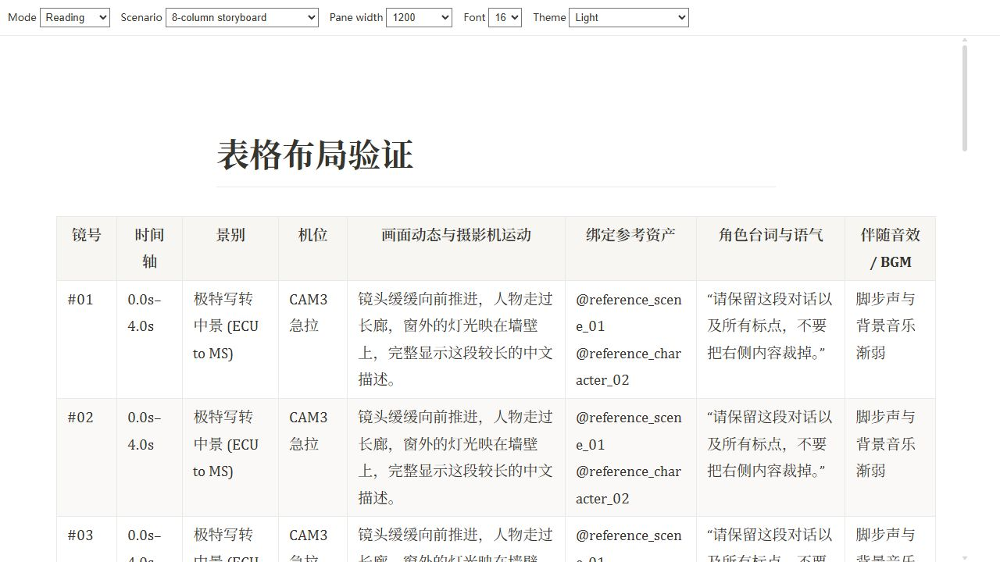
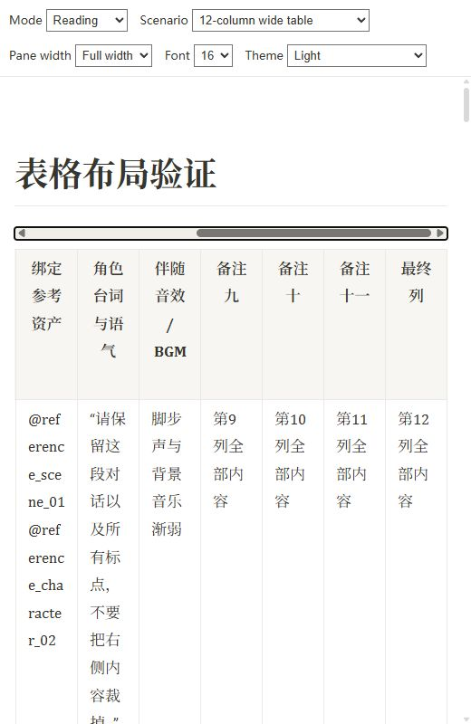
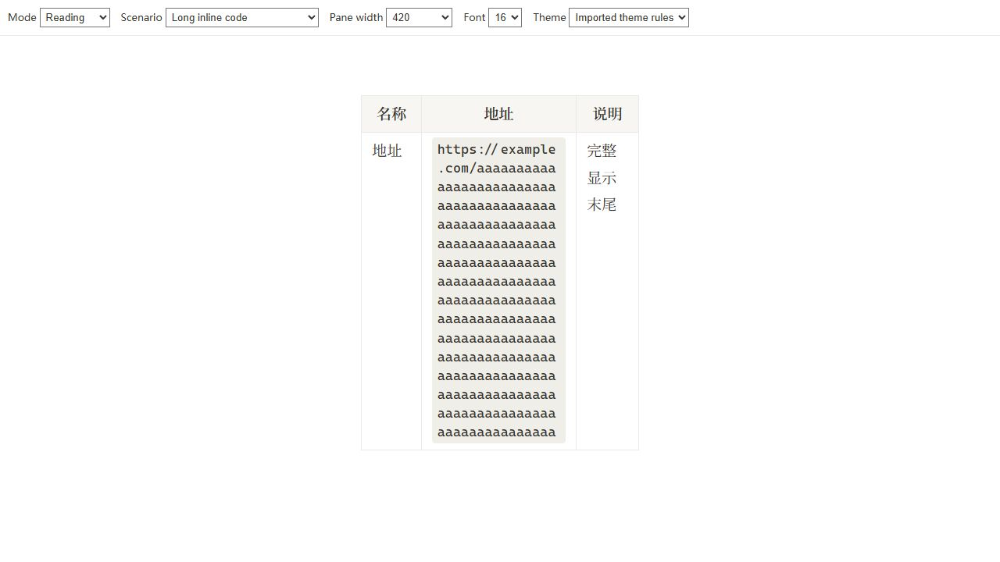

# 浏览器表格布局验收

2026-11-01，使用实际 Preview.vue / Editor.vue 与共享样式；测试数据为合成表格。原始八列十八行文档仅在本机临时验证，未收入仓库或截图。

| 模式 | 列 | 面板宽度 | 区域宽度 | 内容宽度 | 顶部滚动条 | 页面边界 |
| --- | --- | --- | --- | --- | --- | --- |
| reading | 8 | 1200 | 1126 | 1126 | 隐藏 | 无页面溢出 |
| reading | 12 | 420 | 346 | 923 | 显示 | 无页面溢出 |
| preview | 8 | 760 | 677 | 677 | 隐藏 | 无页面溢出 |
| preview | 12 | 420 | 337 | 769 | 显示 | 无页面溢出 |
| live | 8 | 760 | 662 | 662 | 隐藏 | 无页面溢出 |
| live | 12 | 420 | 322 | 673 | 显示 | 无页面溢出 |

额外检查：导入主题布局覆盖、暗色、24px字体、长URL、小表保持正文宽度、原始八列十八行文档，均无页面水平溢出。原始表格在1200px面板中的区域/内容宽均为1126px，最后一列右边界1197.5px，小于区域1198px。

520px真实窄视口：12列内容817px，区域478px，顶部滚动条可见；滚到最右后bar/body均339px，等于最大滚动距离，最后列右边界493.5px，小于区域494px。向下滚动615px后，barTop=hostTop=85px，保持固定。滚动前后表格文本一致。

forcePlain后备模式：真实plain editor已挂载，12列表格区域290px，内容673px，顶部滚动条可见。点击滚动条后表格仍为渲染状态、内容不变。

## 导入主题追加验证

模拟正常主题转换器产生的live/preview table、cell、code规则，设置max-content/fixed、nowrap、300px列宽和code pre。修复前live八列表格在662px区域内被撑至2835.98px；修复后恢复662px、auto/normal。追加长inline code验证：live332/332px、preview347/347px、reading356/356px（区域/内容）；三模式code均normal+anywhere，页面无横向溢出。验证覆盖结构布局优先级，不承诺覆盖任意用户!important规则。

