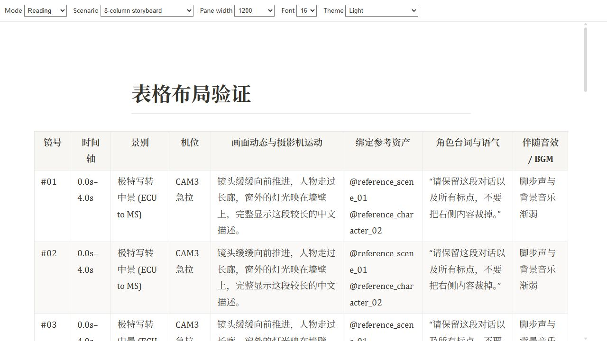
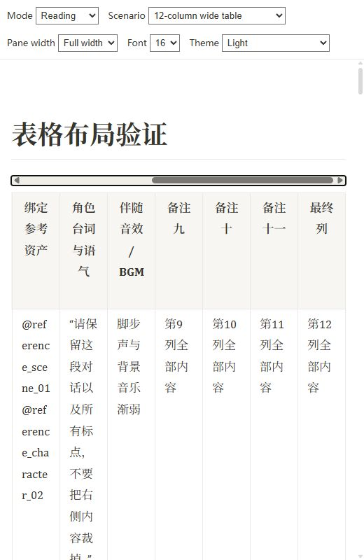
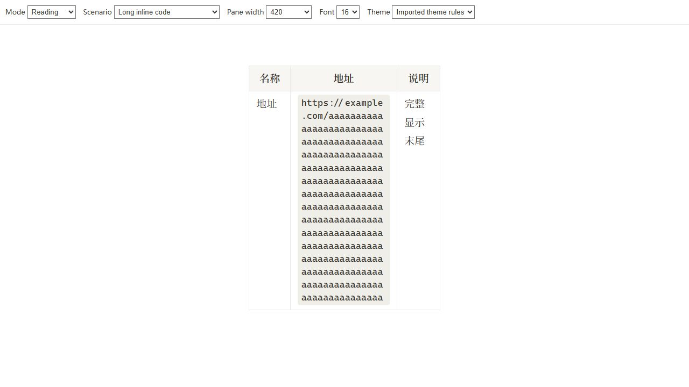

# 表格完整显示修复报告

日期：2026 年 11 月 1 日。对应反馈：八列分镜表在阅读模式下只显示左侧部分，右侧内容看起来被裁切。

## 原因

此前表格使用 `width: max-content`，优先按内容撑宽；阅读正文又限制在约 780px 的列内。八列长文本明显超过该宽度，横向滚动条却位于整张长表的底部，因此在表格顶部不容易发现或操作。

同时，表格局部横向滚动不会触发旧的外层纵向滚动监听，浮动编辑工具条可能停留在旧位置。

## 修改后的行为

- 表格优先适应可用宽度，中文、长链接和内联代码正常换行。
- 阅读和预览中的六列及以上顶级表格使用可用面板宽度；普通段落仍保持原来的阅读宽度，小表不扩展正文栏。
- 超出可读最小列宽时，显示顶部同步的原生横向滚动条。向下阅读长表时，顶部条继续可用，最右侧列可以访问。
- 编辑、阅读、预览和文本后备编辑器共用滚动结构；滚动条点击不会激活源码编辑，横滚时隐藏旧位置的浮动工具条。
- 窗口变化、字体加载和表格重渲染会重新测量；卸载或切换模式时清理观察器和监听器。
- 普通导入主题的撑宽和不换行规则不会覆盖上述结构布局；打印样式同时覆盖预览和文本后备表格。

实现：[共享滚动逻辑](../../../app/src/lib/table-scroll.ts)、[布局样式](../../../app/src/styles/markdown-layout.css)。源码提交：[44fdcfe](https://github.com/maobukeai/catstep-md/commit/44fdcfe44ee52daeb32738aa4102c01cfd62528e)。

## 实际界面验收

使用实际 `Preview.vue`、`Editor.vue` 和生产样式，而不是另写一份效果示意页面。你当前的八列、十八行文档仅在本机临时验证，未改写原文件，也未将其正文或截图提交到仓库。下面的截图使用合成数据。

| 场景 | 结果 |
| --- | --- |
| 八列长文本、1200px 阅读面板 | 表格区域与内容均为 1126px，最后一列在区域内完整显示；普通正文仍为 716px |
| 预览和实时编辑、760px 面板 | 八列正常适应宽度，页面本身不发生横向溢出 |
| 十二列、420px 面板 | 显示顶部滚动条，表格局部横滚，外部页面保持原宽度 |
| 520px 真实窄视口 | 区域 478px、内容 817px；滚至最右端时偏移 339px，等于最大滚动距离 |
| 长表向下滚动 | 父区域滚动 615px 后，滚动条顶部与父区域顶部均为 85px，保持可用 |
| 长 URL、导入主题布局规则、暗色、24px 阅读字体 | 均未造成页面水平溢出；表格保持自动布局及正常换行 |
| 五列小表 | 保留原 780px 正文栏，不触发宽表展开 |
| 文本后备编辑器 | 宽表可横滚，点击滚动条后仍保持渲染状态，内容不变 |

详细记录：[浏览器验收](evidence/table-layout/browser-validation.md)。

追加导入主题复核发现了实时编辑样式的同级覆盖，已将结构规则限定到实际滚动容器，提高优先级。实测修复前，普通主题的 `max-content/fixed/nowrap` 可把 662px 区域中的八列表格撑到约 2836px；修复后恢复为 662px 自动布局。表内长代码在实时、预览、阅读三模式下也均为 `normal + anywhere`，内容宽度分别匹配 332px、347px、356px 的区域宽度。此检查覆盖正常主题转换器产生的规则，不以任意用户 `!important` 样式作为覆盖保证。

## 自动检查

完整前端测试 **673 项通过，0 失败、0 忽略**，包含新增 6 项滚动行为回归和 1 项真实表格 Widget 挂载/销毁回归。测试类型检查、`vue-tsc`、生产构建和国际化检查通过。

证据：[完整测试](evidence/table-layout/frontend-tests.txt)、[类型检查](evidence/table-layout/frontend-types.txt)、[生产构建](evidence/table-layout/frontend-build.txt)。

## 安装包与发布

Windows x64 / ARM64 原生构建：[GitHub Actions 41224270415](https://github.com/maobukeai/catstep-md/actions/runs/41224270415)，最终为 `completed / success`。两架构各 29 项更新器定向测试通过；包内程序、资源、架构、来源及实际安装目录映射核验通过，新 MSI 的 ProductCode / PackageCode 与当前已发布包不同，升级范围包含已安装的 1.0.13，具备同版本覆盖安装条件。

已替换 v1.0.13 的四个 Windows GUI 资产，并在包上传完成后更新完整 SHA-256 清单。重新从 GitHub 标准公开下载地址下载四包及清单，五个文件完整摘要均匹配候选；全部 24 条清单记录与 GitHub API 摘要一致，其余 20 项资产的 ID、大小与摘要保持原值。发布说明已标明本次日期及最终源码来源，保留原发布标签。

| 发布资产 | 字节数 | SHA-256 |
| --- | ---: | --- |
| x64 MSI | 16879616 | `2f6502efa68f91d9c1a809246cc878a5f61f56ba02787fd915ea93c9efe76a22` |
| x64 便携包 | 16369592 | `260719d3da963f412a63aeeccf5b7d2d74250f86aa925c76432fc62288f28483` |
| ARM64 MSI | 16371712 | `738f976dc94021f27716efdf876d5ab1091089c44595d438794910482884b2f4` |
| ARM64 便携包 | 15900709 | `847e6544c66ab422c73bff6f76489c2b667f3c4a03cc94ba29e2123ccc98e14f` |

证据：[产物核验](evidence/table-layout/artifact-verification.md)、[双架构原生回归](evidence/table-layout/ci-native-tests.txt)、[公开下载回验](evidence/table-layout/public-download-verification.txt)。

下载：[Windows x64 修复安装包](https://github.com/maobukeai/catstep-md/releases/download/v1.0.13/CatstepMD_1.0.13_x64_en-US.msi)、[完整发布页](https://github.com/maobukeai/catstep-md/releases/tag/v1.0.13)。本次版本仍为 1.0.13，请保存笔记并退出软件后，重新下载并覆盖安装一次；同版本不会自动提示更新。

## 验收边界

本轮实际界面验收聚焦应用内表格。PDF、图片、独立 HTML 导出有各自的渲染链路，本次未据屏幕效果推定其全部通过。未安装 MSI 或替换用户正在运行的程序。

自动审批拒绝清理本次本地临时验证文件，仅返回 `blocked by policy`，因此未重试删除。临时目录受 Git 忽略，未进入源码提交或 CI 构建；验证页与本地开发服务均已关闭。
